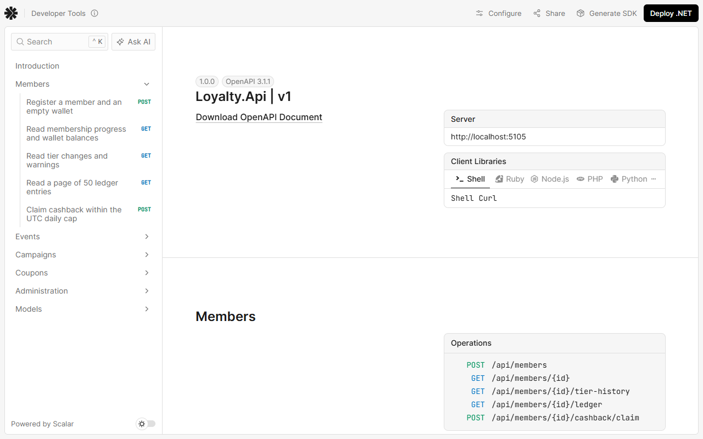
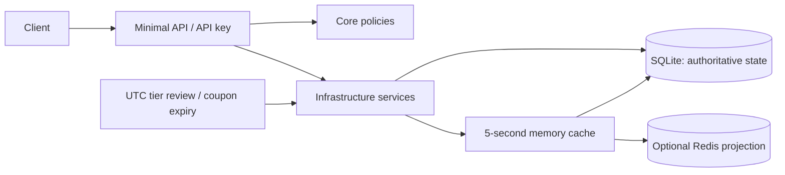

English | [繁體中文](README.zh-TW.md)

# loyalty-engine

[](https://github.com/Marc-YULIN/loyalty-engine/actions/workflows/ci.yml)  

A membership loyalty API with rolling tiers, cashback accounting, resilient leaderboards, and a coupon box.

## Background

Distilled from patterns I built and operated in production payment / membership platforms. This repository is a clean-room implementation with synthetic data.

## Features

- Configurable 30-day spending tiers, immediate upgrades, and one-level downgrades after a 14-day warning period.
- Tier/category cashback, proportional refund reversals, UTC daily claim caps, and replayable claims.
- Spending or purchase-count campaigns with optional Redis, database fallback, and a five-second top-list cache.
- Coupon batches by member list or tier, expiration, and atomic redemption with an audit ledger.
- API-key protection, structured problem responses, OpenAPI, Scalar, health checks, and synthetic demo data.

## Screenshots



*API reference (Scalar)*

## Architecture



See [the architecture reference](docs/architecture.md) for sequences, state transitions, and the data model.

## Tech Stack

- .NET 10, ASP.NET Core Minimal API, EF Core SQLite.
- StackExchange.Redis and in-process memory caching.
- OpenAPI and Scalar; xUnit, NSubstitute, and in-process API integration tests.
- Docker Compose and a main-branch build/test workflow.

## Getting Started

Install the .NET 10 SDK selected by the SDK pin file. From the repository root:

```sh
dotnet restore Loyalty.slnx
dotnet build Loyalty.slnx --no-restore
dotnet run --project src/Loyalty.Api --no-restore --launch-profile http
```

The Development profile listens on `http://localhost:5105`, automatically seeds five members, two coupon templates, a campaign, and purchases spanning 60 days. Redis is disabled by default. The SQLite file is created under the API content directory's `appdata` folder. Schema creation uses `EnsureCreatedAsync`; existing schemas are not migrated.

`/health`, the OpenAPI document (`/openapi/v1.json`) and the Scalar UI (`http://localhost:5105/scalar`) are public. Every `/api/*` route requires `X-Api-Key: dev-loyalty-key` in Development.

For the container demo, set an API key of at least eight characters and start both services (PowerShell):

```powershell
$env:Security__ApiKey = 'sample-local-key'
docker compose up --build -d
curl.exe --fail-with-body http://localhost:5105/health
```

Compose deliberately runs in Development to enable the demo walkthrough. Its named volume preserves SQLite data; Redis remains a disposable projection. To run without Redis in containers:

```powershell
$env:ConnectionStrings__Redis = ''
docker compose up --build -d --no-deps api
```

For a non-demo deployment, use Production, configure a private API key, and provision members/templates through the API; demo seeding is Development-only. The API key is shared by administrative and member operations; there is no member authentication or tenant isolation.

## Configuration

Configuration uses the standard .NET providers. Replace `:` with `__` for environment variables; invalid options fail at startup.

| Key | Default | Meaning |
| --- | --- | --- |
| `ConnectionStrings:Loyalty` | `Data Source=appdata/loyalty-engine.db` | SQLite location, relative to the content directory. |
| `ConnectionStrings:Redis` | empty locally; `redis:6379` in Compose | Empty selects the database-only leaderboard. |
| `Security:ApiKey` | empty; `dev-loyalty-key` in Development | Required, minimum eight characters. Compose requires an environment value. |
| `Loyalty:Currency` | `USD` | Single currency label; no conversion. |
| `Loyalty:RollingWindowDays` | `30` | Qualifying purchase window. Refunds count against their original purchase. |
| `Loyalty:DowngradeGraceDays` | `14` | Grace period for each one-level downgrade. |
| `Loyalty:EnableTierReviewWorker` | `true` | Daily review at 00:10 UTC; coupon expiry still runs every minute. |
| `Loyalty:Tiers` | Bronze 0; Silver 1000; Gold 5000; Platinum 20000 | Configurable spending thresholds. |
| `Loyalty:CashbackRates` | Bronze 0.005; Silver 0.0075; Gold 0.01; Platinum 0.02 | Wildcard category rates; Gold electronics 0.015, Platinum electronics 0.025. |
| `Loyalty:DailyClaimCap` | Bronze 20; Silver 50; Gold 150; Platinum 500 | Maximum claim amount per UTC day and current tier. |

## API Walkthrough

Run this block in PowerShell 7.3+ with curl installed, while the Development server is running. For Compose, replace the key with the value configured above. Each run creates a fresh member, campaign, template, and batch. The helper passes JSON to curl and stops on failed HTTP requests.

```powershell
$base = 'http://localhost:5105'
$key = 'dev-loyalty-key'
$runId = [guid]::NewGuid().ToString('N')
function Invoke-LoyaltyApi {
    param([string]$Method, [string]$Path, [object]$Body = $null)
    $curlArgs = @('--silent', '--show-error', '--fail-with-body', '-X', $Method,
        "$base$Path", '-H', "X-Api-Key: $key")
    if ($null -ne $Body) {
        $curlArgs += @('-H', 'Content-Type: application/json', '--data-binary',
            ($Body | ConvertTo-Json -Depth 8 -Compress))
    }
    $result = & curl.exe @curlArgs
    if ($LASTEXITCODE -ne 0) { throw "HTTP request failed: $result" }
    $result | ConvertFrom-Json
}

# Safe to replay; automatic startup seeding already created the demo records.
Invoke-LoyaltyApi POST /api/dev/seed
$member = Invoke-LoyaltyApi POST /api/members @{
    externalId = "walkthrough-$runId"; displayName = 'Sample Member'
}
$memberId = $member.id
$campaign = Invoke-LoyaltyApi POST /api/campaigns @{
    name = 'Sample Spending Challenge'; metric = 'Spend'
    startsAt = [DateTimeOffset]::UtcNow.AddMinutes(-1).ToString('o')
    endsAt = [DateTimeOffset]::UtcNow.AddDays(30).ToString('o')
    rewardsJson = '[{"from":1,"to":3,"reward":"Member gift"}]'
}
$campaignId = $campaign.id

# Campaigns must exist before the purchase is ingested.
$purchase = @{
    eventId = "purchase-$runId"; memberId = $memberId; type = 'Purchase'
    category = 'electronics'; amount = 6000
    occurredAt = [DateTimeOffset]::UtcNow.AddSeconds(-1).ToString('o')
}
Invoke-LoyaltyApi POST /api/events $purchase
Invoke-LoyaltyApi POST /api/events $purchase # duplicate=true; no extra credit
Invoke-LoyaltyApi GET "/api/members/$memberId" # Gold; claimable cashback 90
Invoke-LoyaltyApi POST /api/events @{
    eventId = "refund-$runId"; memberId = $memberId; type = 'Refund'
    category = 'electronics'; amount = 2000; originalEventId = $purchase.eventId
    occurredAt = [DateTimeOffset]::UtcNow.AddSeconds(-1).ToString('o')
}

# Both bodies are identical; the second response has Idempotent-Replay: true.
curl.exe --fail-with-body -i -X POST "$base/api/members/$memberId/cashback/claim" -H "X-Api-Key: $key" -H "Idempotency-Key: claim-$runId"
curl.exe --fail-with-body -i -X POST "$base/api/members/$memberId/cashback/claim" -H "X-Api-Key: $key" -H "Idempotency-Key: claim-$runId"
Invoke-LoyaltyApi GET "/api/campaigns/$campaignId/leaderboard?top=10"
Invoke-LoyaltyApi GET "/api/campaigns/$campaignId/members/$memberId/rank"
Invoke-LoyaltyApi POST "/api/campaigns/$campaignId/rebuild"

$template = Invoke-LoyaltyApi POST /api/coupon-templates @{
    name = 'Sample Welcome Credit'; discountType = 'FixedAmount'
    value = 10; minSpend = 50; maxDiscount = $null; validDays = 30
}
$batch = @{
    templateId = $template.id
    target = @{ memberIds = @($memberId); batchId = [guid]::NewGuid().ToString() }
}
Invoke-LoyaltyApi POST /api/coupon-batches $batch
Invoke-LoyaltyApi POST /api/coupon-batches $batch # issuedCount=0; skippedCount=1
$coupons = @(Invoke-LoyaltyApi GET "/api/members/$memberId/coupons?status=Available")
$couponId = $coupons[0].id
Invoke-LoyaltyApi POST "/api/members/$memberId/coupons/$couponId/redeem" @{
    orderAmount = 100; orderRef = "sample-order-$runId"
}
Invoke-LoyaltyApi POST /api/admin/tier-review/run
Invoke-LoyaltyApi GET "/api/members/$memberId/tier-history"
Invoke-LoyaltyApi GET "/api/members/$memberId/ledger?page=1"
Invoke-LoyaltyApi GET "/api/members/$memberId"
```

Expected outcome for the new member: qualifying spend 4000, Gold with a downgrade warning, 60 claimed into the balance, zero claimable, campaign score 4000, and one redeemed coupon with discount 10. Coupon redemption records the discount without changing the wallet balance. Without Redis, leaderboard responses report `source: database`.

Batch event ingestion accepts up to 500 events and returns a per-event result. Coupon targets can alternatively select tiers; percentage discounts use fractions (0.1 means 10%). Reuse the batch identity for retries and use a new identity for a distinct issuance. Errors use ProblemDetails with a machine-readable code. Missing API keys return 401, missing claim keys return 400, unavailable coupons return 409, and insufficient order spend returns 422.

## Design Decisions

1. **Database authority, optional Redis.** Event, wallet, ledger, and campaign updates commit together. Redis updates follow the commit; a Redis failure opens a 30-second circuit and reads use the database. Top lists cache for five seconds, so a source change can be delayed by that cache. Recovery rebuilds the projection from committed scores. Database ties prefer the earliest score update, then member ID; Redis uses its native reverse member ordering for equal scores, so tied ranks can differ between sources.
2. **Fast upgrades, gradual downgrades.** A purchase can immediately jump multiple tiers before its cashback rate is calculated. Refunds do not immediately downgrade. Daily or manual reviews establish a warning, then downgrade one level per grace period to reduce tier churn.
3. **Ledger, optimistic concurrency, and idempotency.** Wallet versions detect conflicts, a transaction runner serializes local writers, and retryable conflicts get up to three total attempts. Claim results are stored with a member-scoped unique key and replay the original JSON. The UTC daily sum and wallet update share a transaction. This favors correctness and small deployments over write throughput.
4. **Explicit monetary rounding.** Accruals and proportional cumulative refund reversals round to two decimals using `MidpointRounding.ToEven`. Each partial refund reverses the difference between the cumulative rounded totals, avoiding drift. A full reversal is recorded even when claimable cashback is insufficient; claimable stops at zero. Already claimed balance is not recovered and there is no debt-collection workflow.
5. **Conditional coupon updates.** Redemption requires an available, unexpired row in the update predicate. The transition and ledger write share a transaction. A prior read supplies validation details; it does not authorize an unconditional update. Batches have a unique member pair and a stable request identity, derived from normalized content if omitted. Replaying a tier batch does not expand its original audience.
6. **Event identity and refund linkage.** Globally unique event IDs prevent repeated accrual. Refunds reference the same member/category purchase and cannot cumulatively exceed it. Refunds reduce purchase-count scores only on a full refund. Events with future occurrences are rejected. A reused event ID returns duplicate without comparing payloads, so callers must keep IDs immutable.
7. **Fixed-point SQLite storage.** Core calculations use decimal. Persisted decimals use signed 64-bit integers scaled by 10000, allowing SQL sums, ordering, and comparisons without floating-point conversion. Inputs accept at most four fractional digits within the storage bound. Redis sorted sets use floating-point scores as an approximate projection; SQLite retains the exact value. UTC instants are stored as ticks.
8. **Deliberately bounded demo.** Schema initialization is suitable for a fresh local database, not schema upgrades. Campaigns must be created before their purchases are ingested: a campaign created afterward with a backdated start cannot precisely attribute earlier contributions in this schema, and historical backfill is not implemented. Rewards are descriptions, not automatic fulfillment. Tier review times should move forward; historical rewind of current membership state is not provided.

## Testing

```sh
dotnet build Loyalty.slnx --no-restore
dotnet test Loyalty.slnx --no-restore
```

Tests cover tier transitions, rounding/refunds, claim caps, coupon rules, duplicate events, concurrent claims, claim replay, concurrent redemption, batch replay, database ties, cache invalidation, circuit recovery, and API validation. Integration classes use isolated temporary SQLite files, a controllable clock, and no live Redis dependency. Live Redis recovery and container image execution require separate smoke checks.

## Project Structure

```text
src/Loyalty.Core/             Entities, contracts, options, pure policies
src/Loyalty.Infrastructure/   SQLite, transactions, services, stores, workers
src/Loyalty.Api/              Endpoint groups, composition, settings, HTTP examples
tests/Loyalty.Tests/          Policy, service, and API integration tests
docs/architecture.md         Sequences, states, and data model
Dockerfile                   Multi-stage API image
docker-compose.yml           API, Redis, persistent SQLite volume
.github/workflows/ci.yml      Main-branch build and test
```

## Roadmap

- Per-event campaign contribution history and explicitly specified historical backfill.
- Schema migrations, member-scoped authorization, and distributed write scalability.
- Durable projection dispatch and identical tie-breaking across leaderboard sources.
- Automated reward fulfillment and an explicit recovery policy for already claimed refunds.

## License

[MIT](LICENSE).
