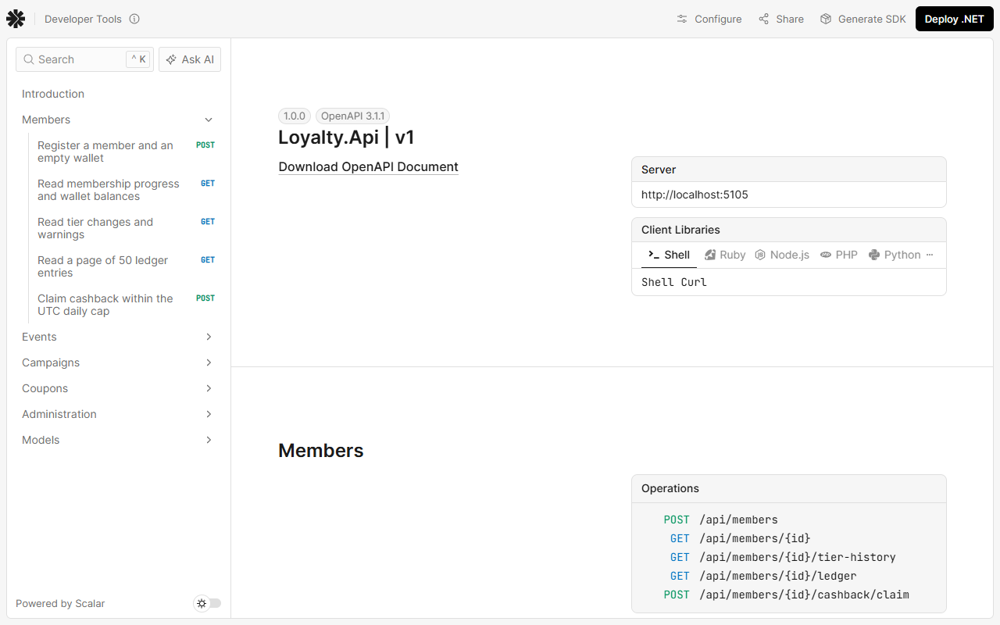
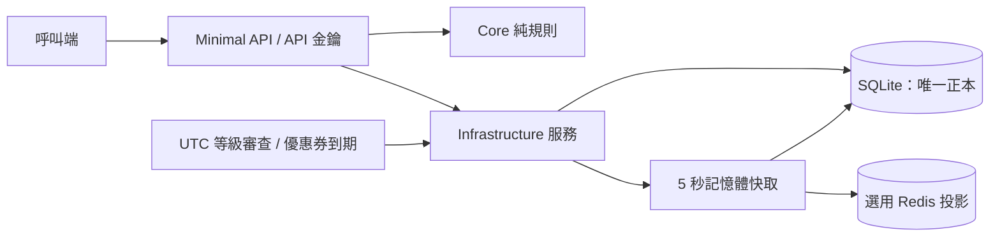

[English](README.md) | 繁體中文

# loyalty-engine

[](https://github.com/Marc-YULIN/loyalty-engine/actions/workflows/ci.yml)  

提供滾動會員等級、回饋金帳務、具備故障降級能力的排行榜與優惠券箱的會員忠誠度 API。

## 背景

本專案萃取自我在正式環境建置及維運大型會員平台的實務模式，以獨立重新實作與合成資料呈現。

## 功能

- 可設定的 30 天消費等級、即時升級，以及警告 14 天後每次降一級的寬限機制。
- 依等級及商品類別計算回饋金，支援比例退款沖回、UTC 每日領取上限與冪等重送。
- 消費金額或購買次數排行榜，支援選用 Redis、資料庫降級與 5 秒熱門名單快取。
- 依會員名單或等級批次發券，支援到期、原子兌換及折扣帳本。
- API 金鑰保護、結構化問題回應、OpenAPI、Scalar、健康檢查與合成示範資料。

## 畫面截圖



*API 文件（Scalar）*

## 架構



完整時序、狀態與資料模型見[架構文件 (architecture.md)](docs/architecture.md)。

## 技術組成

- .NET 10、ASP.NET Core Minimal API、EF Core SQLite。
- StackExchange.Redis 與程序內記憶體快取。
- OpenAPI 與 Scalar；xUnit、NSubstitute 及程序內 API 整合測試。
- Docker Compose 與主分支建置／測試工作流程。

## 快速開始

先安裝 SDK 鎖定設定檔 (global.json) 指定的 .NET 10 SDK，在專案根目錄執行：

```sh
dotnet restore Loyalty.slnx
dotnet build Loyalty.slnx --no-restore
dotnet run --project src/Loyalty.Api --no-restore --launch-profile http
```

開發啟動設定 (http) 使用 `http://localhost:5105`，自動建立 5 位會員、2 個優惠券範本、1 個活動及橫跨 60 天的購買資料。預設不需要 Redis。SQLite 檔案位於 API 內容目錄下的 `appdata`；啟動建庫方法 (EnsureCreatedAsync) 只建立結構，不遷移既有資料庫。

`/health`、OpenAPI 文件（`/openapi/v1.json`）與 Scalar 介面（`http://localhost:5105/scalar`）可直接開啟；所有 `/api/*` 路徑在開發環境都需要 `X-Api-Key: dev-loyalty-key`。

容器示範先設定至少 8 個字元的金鑰，再啟動兩個服務（PowerShell）：

```powershell
$env:Security__ApiKey = 'sample-local-key'
docker compose up --build -d
curl.exe --fail-with-body http://localhost:5105/health
```

容器編排檔 (docker-compose.yml) 使用 Development 環境，讓下方示範可以直接操作。具名 volume 保存 SQLite 資料，Redis 可隨時從資料庫重建。若容器也不使用 Redis：

```powershell
$env:ConnectionStrings__Redis = ''
docker compose up --build -d --no-deps api
```

非示範部署請使用 Production、自行設定私密金鑰，並透過 API 建立會員與範本；示範資料僅在 Development 提供。管理與會員操作共用同一把 API 金鑰，目前沒有會員登入或租戶隔離。

## 設定

採用 .NET 標準設定來源；環境變數以 `__` 取代 `:`。設定不合法時，應用程式會在啟動時失敗。

| 設定鍵 | 預設值 | 說明 |
| --- | --- | --- |
| 資料庫連線 (ConnectionStrings:Loyalty) | `Data Source=appdata/loyalty-engine.db` | 相對於內容目錄的 SQLite 位置。 |
| 排行榜快取連線 (ConnectionStrings:Redis) | 本機空白；Compose 為 `redis:6379` | 空白代表排行榜只使用資料庫。 |
| API 金鑰 (Security:ApiKey) | 空白；Development 為 `dev-loyalty-key` | 至少 8 個字元；Compose 要求透過環境變數提供。 |
| 單一幣別 (Loyalty:Currency) | `USD` | 幣別標示，不進行換匯。 |
| 滾動天數 (Loyalty:RollingWindowDays) | `30` | 合格購買期間；退款歸回原購買計算。 |
| 降級寬限天數 (Loyalty:DowngradeGraceDays) | `14` | 每次降一級前的寬限期。 |
| 等級審查開關 (Loyalty:EnableTierReviewWorker) | `true` | 每天 UTC 00:10 審查；優惠券仍每分鐘到期處理。 |
| 等級門檻 (Loyalty:Tiers) | Bronze 0；Silver 1000；Gold 5000；Platinum 20000 | 可調整的消費門檻。 |
| 回饋比例 (Loyalty:CashbackRates) | Bronze 0.005；Silver 0.0075；Gold 0.01；Platinum 0.02 | 通用類別比例；Gold 電子商品 0.015，Platinum 電子商品 0.025。 |
| 每日領取上限 (Loyalty:DailyClaimCap) | Bronze 20；Silver 50；Gold 150；Platinum 500 | 依目前等級與 UTC 日期計算。 |

## API 操作範例

Development 伺服器啟動後，以裝有 curl 的 PowerShell 7.3 以上版本執行整段指令；若使用 Compose，請換成前面設定的金鑰。每次建立新的會員、活動、範本與批次。輔助函式將 JSON 傳給 curl，HTTP 失敗時停止。

```powershell
$base = 'http://localhost:5105'
$key = 'dev-loyalty-key'
$runId = [guid]::NewGuid().ToString('N')
function Invoke-LoyaltyApi {
    param([string]$Method, [string]$Path, [object]$Body = $null)
    $curlArgs = @('--silent', '--show-error', '--fail-with-body', '-X', $Method,
        "$base$Path", '-H', "X-Api-Key: $key")
    if ($null -ne $Body) {
        $curlArgs += @('-H', 'Content-Type: application/json', '--data-binary',
            ($Body | ConvertTo-Json -Depth 8 -Compress))
    }
    $result = & curl.exe @curlArgs
    if ($LASTEXITCODE -ne 0) { throw "HTTP request failed: $result" }
    $result | ConvertFrom-Json
}

# Safe to replay; automatic startup seeding already created the demo records.
Invoke-LoyaltyApi POST /api/dev/seed
$member = Invoke-LoyaltyApi POST /api/members @{
    externalId = "walkthrough-$runId"; displayName = 'Sample Member'
}
$memberId = $member.id
$campaign = Invoke-LoyaltyApi POST /api/campaigns @{
    name = 'Sample Spending Challenge'; metric = 'Spend'
    startsAt = [DateTimeOffset]::UtcNow.AddMinutes(-1).ToString('o')
    endsAt = [DateTimeOffset]::UtcNow.AddDays(30).ToString('o')
    rewardsJson = '[{"from":1,"to":3,"reward":"Member gift"}]'
}
$campaignId = $campaign.id

# Campaigns must exist before the purchase is ingested.
$purchase = @{
    eventId = "purchase-$runId"; memberId = $memberId; type = 'Purchase'
    category = 'electronics'; amount = 6000
    occurredAt = [DateTimeOffset]::UtcNow.AddSeconds(-1).ToString('o')
}
Invoke-LoyaltyApi POST /api/events $purchase
Invoke-LoyaltyApi POST /api/events $purchase # duplicate=true; no extra credit
Invoke-LoyaltyApi GET "/api/members/$memberId" # Gold; claimable cashback 90
Invoke-LoyaltyApi POST /api/events @{
    eventId = "refund-$runId"; memberId = $memberId; type = 'Refund'
    category = 'electronics'; amount = 2000; originalEventId = $purchase.eventId
    occurredAt = [DateTimeOffset]::UtcNow.AddSeconds(-1).ToString('o')
}

# Both bodies are identical; the second response has Idempotent-Replay: true.
curl.exe --fail-with-body -i -X POST "$base/api/members/$memberId/cashback/claim" -H "X-Api-Key: $key" -H "Idempotency-Key: claim-$runId"
curl.exe --fail-with-body -i -X POST "$base/api/members/$memberId/cashback/claim" -H "X-Api-Key: $key" -H "Idempotency-Key: claim-$runId"
Invoke-LoyaltyApi GET "/api/campaigns/$campaignId/leaderboard?top=10"
Invoke-LoyaltyApi GET "/api/campaigns/$campaignId/members/$memberId/rank"
Invoke-LoyaltyApi POST "/api/campaigns/$campaignId/rebuild"

$template = Invoke-LoyaltyApi POST /api/coupon-templates @{
    name = 'Sample Welcome Credit'; discountType = 'FixedAmount'
    value = 10; minSpend = 50; maxDiscount = $null; validDays = 30
}
$batch = @{
    templateId = $template.id
    target = @{ memberIds = @($memberId); batchId = [guid]::NewGuid().ToString() }
}
Invoke-LoyaltyApi POST /api/coupon-batches $batch
Invoke-LoyaltyApi POST /api/coupon-batches $batch # issuedCount=0; skippedCount=1
$coupons = @(Invoke-LoyaltyApi GET "/api/members/$memberId/coupons?status=Available")
$couponId = $coupons[0].id
Invoke-LoyaltyApi POST "/api/members/$memberId/coupons/$couponId/redeem" @{
    orderAmount = 100; orderRef = "sample-order-$runId"
}
Invoke-LoyaltyApi POST /api/admin/tier-review/run
Invoke-LoyaltyApi GET "/api/members/$memberId/tier-history"
Invoke-LoyaltyApi GET "/api/members/$memberId/ledger?page=1"
Invoke-LoyaltyApi GET "/api/members/$memberId"
```

新會員預期結果：合格消費 4000、Gold 且有降級警告、已領取 60 至餘額、待領取為零、活動分數 4000，並兌換一張折扣 10 的優惠券。優惠券兌換只記錄折扣，不扣錢包餘額。不使用 Redis 時，排行榜資料來源欄位 (source) 為 `database`。

批次事件最多 500 筆，回傳逐筆結果。優惠券也可依等級發放；百分比使用小數（0.1 表示 10%）。重送時沿用批次識別，新的發放使用新的識別。錯誤採 ProblemDetails 與機器可讀的錯誤碼：未帶 API 金鑰回 401、未帶領取冪等鍵回 400、優惠券不可用回 409、訂單未達低消回 422。

## 設計取捨

1. **資料庫為正本，Redis 為選用加速層。** 事件、錢包、帳本與活動分數在同一交易提交後，才更新 Redis；Redis 失敗會開啟 30 秒斷路並改讀資料庫。熱門名單快取 5 秒，因此來源切換可能延後。恢復時從已提交分數重建投影。資料庫同分先比更新時間，再比會員識別；Redis 同分使用原生會員反向排序，因此兩種來源的同分名次可能不同。
2. **升級即時，降級漸進。** 購買可直接跳級，再以新等級計算該筆回饋；退款不立即降級。每日或手動審查先建立警告，寬限後每次只降一級，降低等級反覆變動。
3. **帳本、樂觀鎖與冪等三層保護。** 錢包版本欄位 (Wallet.Version) 偵測衝突，交易執行器 (TransactionRunner) 序列化同程序寫入，可重試衝突最多共嘗試 3 次。領取以會員範圍的唯一鍵儲存原始 JSON 結果；UTC 當日加總與錢包更新在同一交易完成。此設計優先支援小型部署與正確性，吞吐量受寫入序列化限制。
4. **明確定義金額捨入。** 累積回饋與累計比例退款使用偶數捨入 (MidpointRounding.ToEven)，保留小數兩位。部分退款沖回「累計捨入結果之差」，避免逐筆誤差。待領取不足時仍完整記錄沖回帳本，待領取最低為零；已領取餘額不追扣，目前沒有負債回收流程。
5. **優惠券使用條件式更新。** 更新條件同時要求可用且未到期，狀態轉換與帳本在同一交易完成。前置查詢提供錯誤原因，並不取代原子更新。發券以批次／會員唯一配對防重；未提供批次識別時，從正規化請求內容推導。等級批次重送不會擴充原始發放名單。
6. **事件識別與退款關聯。** 全域唯一事件識別欄位 (ActivityEvent.EventId) 防止重複累積。退款必須指向同會員、同類別的原購買，累計不得超過購買金額；購買次數活動只在全額退款時減一次。未來事件會被拒絕；重用事件識別會直接回報重複，不比對內容，因此呼叫端必須維持識別不可變。
7. **SQLite 使用定點金額。** 領域計算使用 decimal，持久化時乘以 10000 存入有號 64 位元整數，讓 SQL 加總、排序與比較不必轉浮點數。輸入最多 4 位小數且不可超過儲存上限。Redis 分數使用浮點投影，精確值仍以 SQLite 為準；UTC 時間以 ticks 儲存。
8. **示範範圍與已知限制。** 建庫流程只適用新資料庫，不處理結構升級。活動必須先於購買進件建立：事後新增、起始時間回溯的活動，現有模型無法精準歸屬舊購買貢獻，也未實作歷史補算。活動獎勵只有描述，沒有自動發獎。等級審查時間應向前推進，不提供目前會員狀態的歷史回溯重建。

## 測試

```sh
dotnet build Loyalty.slnx --no-restore
dotnet test Loyalty.slnx --no-restore
```

測試涵蓋等級轉換、捨入／退款、領取上限、優惠券規則、重複事件、並行領取、冪等重播、並行兌換、批次重送、資料庫同分排序、快取失效、斷路恢復及 API 驗證。整合測試類別使用獨立暫存 SQLite、可控時鐘，不連線真實 Redis；真實 Redis 恢復與容器執行需另做冒煙測試。

## 專案結構

```text
src/Loyalty.Core/             實體、合約、設定、純規則
src/Loyalty.Infrastructure/   SQLite、交易、服務、儲存層、背景工作
src/Loyalty.Api/              端點分組、組裝、設定、HTTP 範例
tests/Loyalty.Tests/          規則、服務與 API 整合測試
docs/architecture.md         時序、狀態與資料模型
Dockerfile                   多階段 API 映像
docker-compose.yml           API、Redis、SQLite 持久化 volume
.github/workflows/ci.yml      主分支建置與測試
```

## 後續規劃

- 逐事件活動貢獻歷程與明確定義的歷史補算。
- 結構遷移、會員範圍授權與分散式寫入擴展。
- 可持久重試的投影更新，以及跨排行榜來源一致的同分規則。
- 自動發獎與已領取回饋退款的回收政策。

## 授權

[MIT](LICENSE)。
