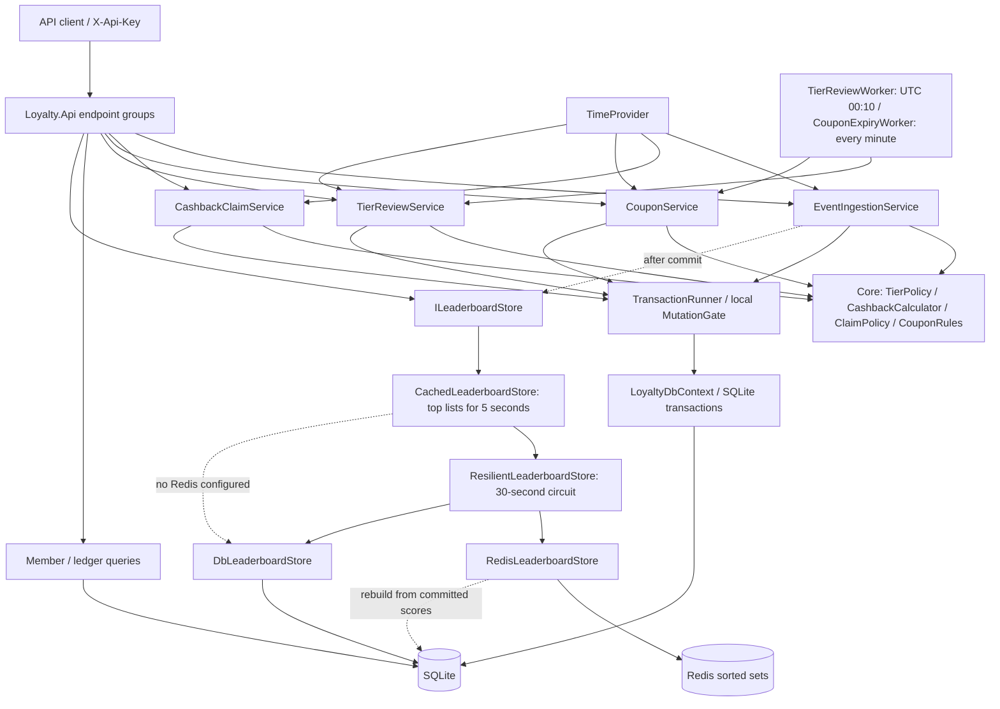
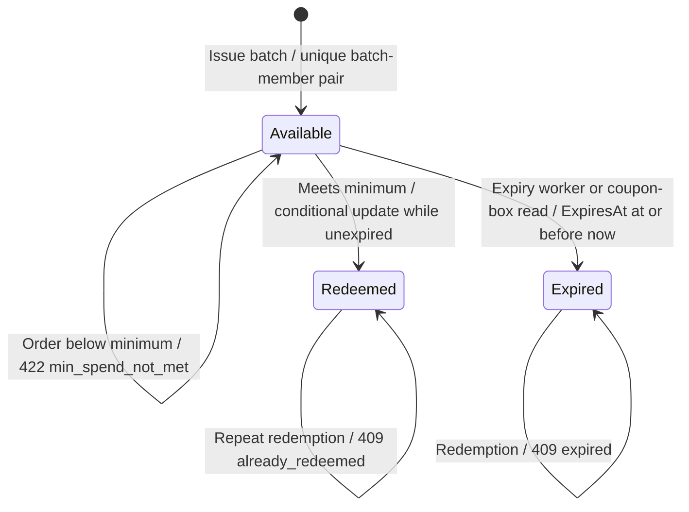
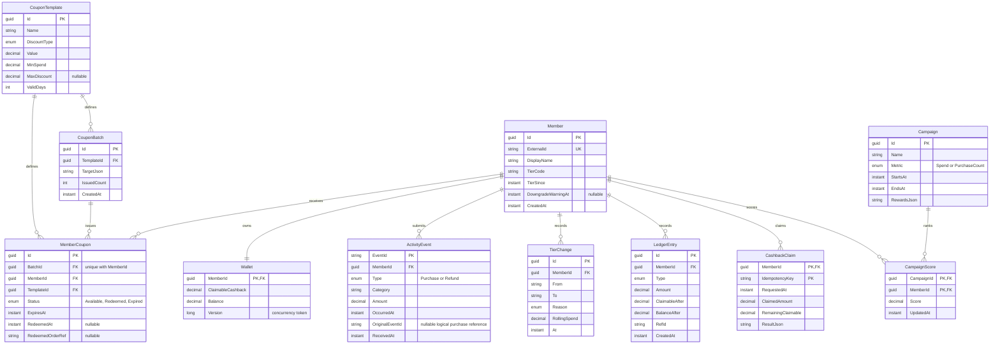

# Architecture

The database owns membership, wallet, ledger, claims, campaign scores, and coupons. Redis is an optional, rebuildable leaderboard projection. HTTP endpoints validate requests and delegate mutations to infrastructure services; domain policies have no HTTP or database dependency.

## Components



With no Redis connection string, the cache wraps the database store directly. The cache is keyed by campaign, requested top count, and invalidation version. Rank lookups bypass the top-list cache. Redis failures are logged, open the circuit for 30 seconds, and send reads to the database; Redis write failures do not undo committed database transactions. After recovery, dirty or uninitialized projections rebuild from database scores. An explicit rebuild endpoint also invalidates the top-list cache.

Database scores order by descending score, earliest update, then member ID. Redis sorts equal scores by its native reverse member order. Tied ranks therefore need not match across sources. Redis scores are floating-point projections; authoritative decimal values remain in SQLite. The current implementation rebuilds the campaign snapshot after Redis increments, trading write cost for synchronization simplicity. Durable dispatch and coordination between multiple API instances remain future work.

## Purchase and refund ingestion

```mermaid
sequenceDiagram
    autonumber
    participant C as Client
    participant A as EventEndpoints
    participant S as EventIngestionService
    participant T as TransactionRunner
    participant D as SQLite
    participant P as Core policies
    participant L as Leaderboard store
    C->>A: POST /api/events (unique EventId)
    A->>S: IngestAsync(dto, cancellationToken)
    S->>S: Validate identity, precision, occurrence
    S->>T: RunAsync (up to 3 total attempts)
    T->>D: Begin transaction; load member; check EventId
    alt Event already exists
        D-->>T: Existing event
        T->>D: Commit without new writes
        T-->>S: duplicate=true
    else New event
        opt Refund
            T->>D: Validate original member/category purchase and refund total
        end
        T->>D: Insert event; save inside transaction
        alt Purchase
            T->>D: Sum qualifying rolling purchases minus linked refunds
            T->>P: Evaluate tier; accrue using resulting tier
            T->>D: Apply upgrade or clear warning; update wallet and ledger
        else Refund
            T->>P: Compute cumulative proportional reversal difference
            T->>D: Clamp claimable to zero; record full reversal
        end
        T->>D: Update campaign scores; increment wallet version
        T->>D: Save and commit event, wallet, ledger, tier, scores
        T-->>S: Committed result and campaign deltas
        S->>L: IncrementAsync after commit; invalidate cache
        Note over L,D: Redis failure falls back to committed database scores
    end
    S-->>A: IngestResult
    A-->>C: 200 JSON
```

Qualifying spend uses purchases in the rolling window through the evaluation time, less refunds linked to those purchases with an occurrence no later than the evaluation time. A late refund of a purchase outside that window does not reduce unrelated current spending. Future occurrences are rejected. Refunds must occur no earlier than the original purchase, match its member/category, and not exceed its remaining refundable amount.

Purchases can immediately upgrade or clear an existing warning; a refund leaves downgrade decisions to review. A spend campaign reverses the refunded amount. A purchase-count campaign loses one count only when the original purchase becomes fully refunded. Refunds can reverse an already-ended campaign's score when the purchase belonged to its window.

**Known attribution boundary:** campaigns must exist before their purchases are ingested. The schema has no per-event campaign contribution history. Creating a campaign after purchase ingestion with a backdated start cannot precisely distinguish earlier contributions during later refunds; historical backfill is not supported. Rewards are descriptive JSON and are not fulfilled automatically.

## Cashback claim

```mermaid
sequenceDiagram
    autonumber
    participant C as Client
    participant A as MemberEndpoints
    participant S as CashbackClaimService
    participant T as TransactionRunner
    participant D as SQLite
    participant P as ClaimPolicy
    C->>A: POST cashback/claim + Idempotency-Key
    A->>A: Require a single nonempty key
    A->>S: ClaimAsync(memberId, key)
    S->>T: Acquire local writer gate; begin transaction
    T->>D: Read claim by (MemberId, IdempotencyKey)
    alt Existing claim
        D-->>T: Stored ResultJson
        T-->>S: Original body; Replay=true
    else New key
        T->>D: Read member, wallet, and claimed total for UTC day
        T->>P: min(claimable, max(0, dailyCap - claimedToday))
        P-->>T: Claim amount and remaining claimable
        T->>D: Update wallet and version
        T->>D: Add ledger entry and claim with serialized result
        T->>D: Save and commit together
        Note over T,D: Retryable conflicts restart with a new context; maximum 3 attempts
        T-->>S: Stored body; Replay=false
    end
    S-->>A: ClaimResponse
    A-->>C: 200 original JSON; Idempotent-Replay true on replay
```

Claim keys are scoped to a member. A replay preserves the original response, even after later wallet changes or a UTC date change. Distinct concurrent keys share the UTC-day cap and available cashback. A zero-value claim is also persisted and replayable. Wallet versions, unique keys, and the transaction protect the mutation; the in-process gate serializes SQLite writers. Persistent retryable conflicts return 409 with a concurrency code.

Accruals and cumulative proportional reversals use two-decimal `MidpointRounding.ToEven`. The full reversal amount remains in the ledger if claimable cashback is insufficient; claimable stops at zero and already claimed balance is not recovered. Coupon redemption is an audit entry for the discount and does not debit the wallet.

## Tier state transitions

```mermaid
stateDiagram-v2
    [*] --> Stable: Register at lowest configured tier
    Stable --> Stable: Qualifies for current tier
    Stable --> Stable: Qualifies higher / upgrade directly
    Stable --> Warning: Review qualifies lower / record warning
    Warning --> Warning: Lower qualification within grace
    Warning --> Stable: Qualifies current / clear warning
    Warning --> Stable: Qualifies higher / upgrade and clear warning
    Warning --> Stable: Grace elapsed / lower one level; now qualifies
    Warning --> Warning: Grace elapsed / lower one level; reset warning if still below
```



Thresholds default to Bronze 0, Silver 1000, Gold 5000, and Platinum 20000 over 30 days. Grace defaults to 14 days per downward step; the lowest tier cannot drop further. Reviews page through 500 members at a time, write tier history for changes/warnings, and summarize upgrades, warnings, downgrades, and cleared warnings. The worker runs daily at 00:10 UTC unless disabled; manual review remains available. Evaluation times should progress forward because current state is not an event-sourced historical reconstruction.

## Coupon state transitions



Time validity is checked during redemption even before the expiry worker marks the row. A conditional database update requires available status and an expiration strictly after now; a successful update and the coupon ledger entry commit together. Fixed or fractional percentage discounts cannot exceed the order amount or the optional maximum, and use two-decimal even rounding.

Issuance accepts either member IDs or tier codes. Requests use an explicit batch identity or derive one from normalized template, target, and explicit expiration content. Replaying the same identity returns the original issued count as skipped and issues nothing; different content under an existing identity is a 409 conflict. Tier audience membership is resolved for the initial batch only. Inserts use chunks of 1000 inside the transaction.

## Data model

The diagram shows persisted relationships; the original event ID is a validated logical reference rather than a declared database foreign key. All monetary decimals and scores use signed 64-bit fixed-point storage scaled by 10000, while Core exposes decimal. Instants use UTC ticks. Unique constraints enforce external member IDs, event IDs, member-scoped claim keys, campaign/member scores, and batch/member coupons.



## Runtime and operational boundaries

- Startup creates the SQLite directory and calls `EnsureCreatedAsync`. Schema migrations are not included.
- Development startup seeds fixed demo identities and immutable event IDs; replay does not duplicate those events. The seed endpoint is unavailable outside Development.
- All routes except health require the shared API key, including OpenAPI and Scalar. Domain errors use ProblemDetails with a code extension.
- Local default mode needs no Redis. Compose uses an API container, optional Redis projection, and a named SQLite volume; its Development setting is for demonstrations.
- Tests isolate SQLite files and replace the clock. Redis failure/circuit behavior is tested with substitutes; real Redis stop/restart and container execution need separate smoke checks.
